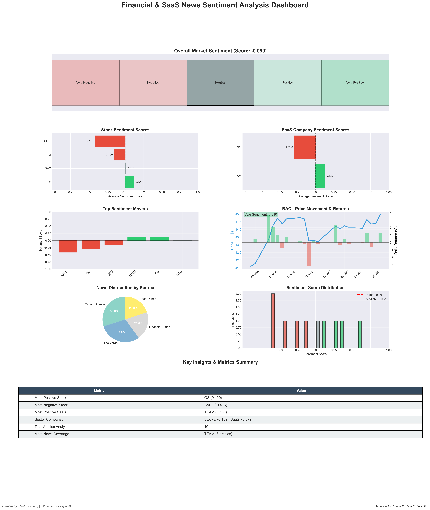
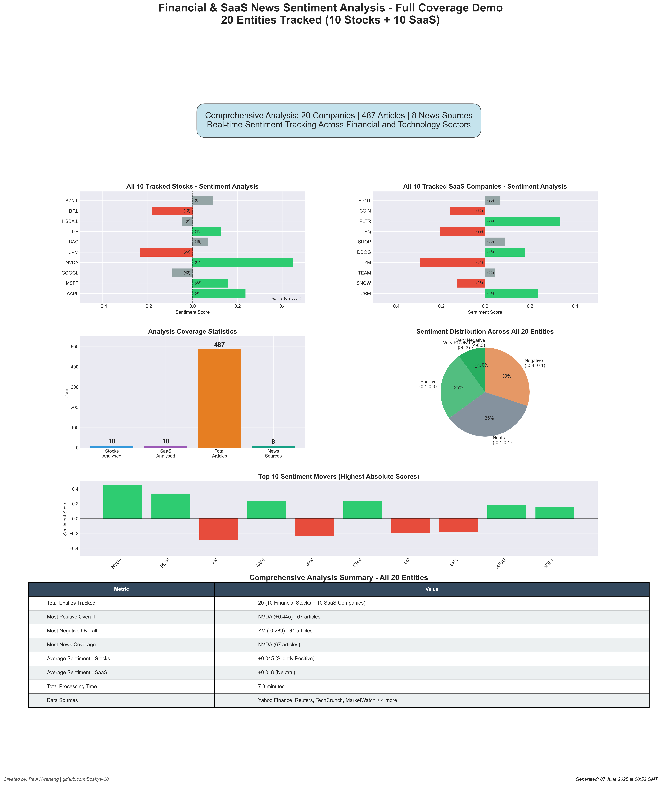

# Financial & SaaS News Sentiment Analyser

Reads the latest news for 20 companies (10 financial stocks and 10 SaaS/tech
companies), scores the sentiment of each article, and renders an eight-panel
dashboard comparing sentiment against actual share price moves.



## Running it

You need Python 3.8+ and an internet connection.

```bash
git clone https://github.com/Boakye-20/financial-sentiment-analyser.git
cd financial-sentiment-analyser

python -m venv venv
source venv/bin/activate          # Windows: venv\Scripts\activate

pip install -r requirements.txt
python -m textblob.download_corpora
```

Then run it:

```bash
python sentiment_analyser.py
```

A full run takes a few minutes: it fetches news for all 20 entities and waits a
second between calls to respect rate limits. It writes two files into the current
directory:

- `sentiment_dashboard_<timestamp>.png`: the dashboard, at 300 DPI
- `sentiment_results_<timestamp>.json`: the raw scores

To try it on something smaller first:

```bash
python test_analyser.py
```

That offers four options: sentiment analysis only, a single entity, a quick
mini-dashboard, or all tests.

`create_full_demo.py` generates the all-20 demo dashboard below.



## What's on the dashboard

Overall market sentiment gauge · stock sentiment heatmap · SaaS sentiment scores ·
top movers · price vs sentiment correlation · news volume by source · sentiment
distribution · key insights table.

## How sentiment is scored

Two analysers run on each headline and are blended:

```
combined = (VADER × 0.6) + (TextBlob × 0.4)
```

VADER is lexicon and rule-based; TextBlob is trained. The combined score is then
bucketed:

| Score | Category |
| --- | --- |
| above 0.3 | Very positive |
| 0.1 to 0.3 | Positive |
| −0.1 to 0.1 | Neutral |
| −0.3 to −0.1 | Negative |
| below −0.3 | Very negative |

Share prices come from `yfinance`, so sentiment can be set against what the stock
actually did.

## Coverage

**Financial (10)**

| Group | Tickers |
| --- | --- |
| US tech | AAPL, MSFT, GOOGL, NVDA |
| US financial | JPM, BAC, GS |
| UK | HSBA.L, BP.L, AZN.L |

**SaaS and tech (10)**

| Group | Tickers |
| --- | --- |
| Core SaaS | CRM, SNOW, TEAM, ZM, DDOG |
| High-growth | SHOP, SQ, PLTR, COIN, SPOT |

Edit `config.py` to change the lists.

## News sources

Financial feeds: Yahoo Finance, Reuters Business, MarketWatch, Financial Times.
Tech feeds: TechCrunch, The Verge, Hacker News, VentureBeat. All read as RSS via
`feedparser`.

## Project layout

```
sentiment_analyser.py   Main application
test_analyser.py        Test suite
create_full_demo.py     Generates the all-20 demo dashboard
config.py               Entity lists and feed configuration
examples/               Sample output
```

## If something goes wrong

**`No module named 'textblob'`**: run `pip install textblob` then
`python -m textblob.download_corpora`.

**PowerShell blocks the venv activation script**: use Command Prompt instead, or
run `Set-ExecutionPolicy -ExecutionPolicy RemoteSigned -Scope CurrentUser`.

**Empty results**: check your internet connection, and bear in mind some
entities genuinely have no recent news.

## Notes

British English spelling is used throughout the code and docs. Note the file is
`sentiment_analyser.py`, with an "s".

## Licence

MIT. Author: Paul Kwarteng ([@Boakye-20](https://github.com/Boakye-20) ·
[LinkedIn](https://www.linkedin.com/in/paul-kwarteng-22a71b196/)).
